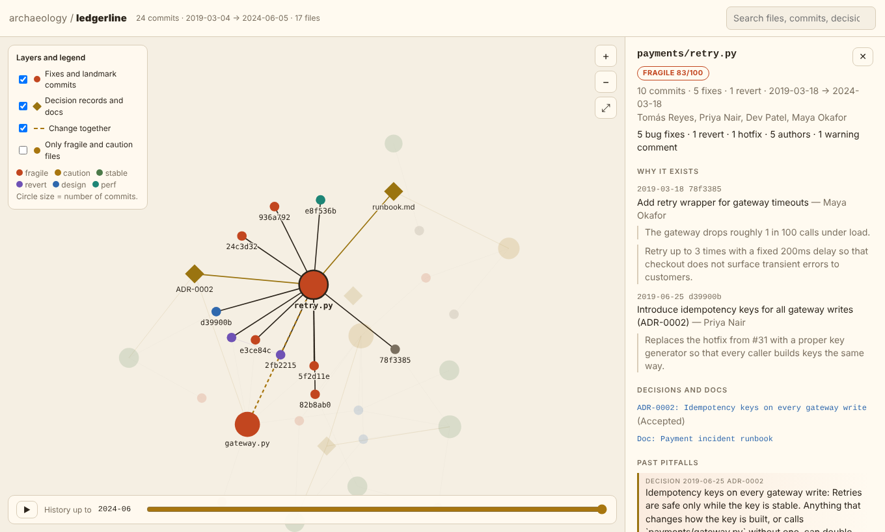

# pr-archaeologist

Reconstruct the historical *why* behind a legacy codebase, and hand it to the next person or coding
agent before they edit a fragile file.

`pr-archaeologist` reads `git log`, `git blame`, commit messages and the Markdown/ADR docs already in
a repository, and maps every file and function to the intent that created it and the bugs that
shaped it. It writes:

- **`archaeology-graph.html`**: a single self-contained interactive knowledge graph (no CDN, no
  build step, works offline and on a phone).
- **`CODEBASE_ARCHAEOLOGY.md`**: an index AI coding agents can read or grep before editing.
- **`pr-archaeologist explain <path>`**: a concise terminal timeline of why a module exists and
  what bit people before.

It has no dependencies beyond Python 3.10+ and the `git` binary, makes no network calls, and uses no
LLM. A nightly run only analyses commits added since the previous run.



## Quick start

```bash
pipx install git+https://github.com/TwoMuchLabs/pr-archaeologist
# or: pip install git+https://github.com/TwoMuchLabs/pr-archaeologist

cd /path/to/your/repo
pr-archaeologist dig                      # first run reads the full history
pr-archaeologist explain src/billing/retry.py
open archaeology-graph.html
```

Not on PyPI yet, so it installs straight from GitHub.

To try it without a repo of your own, build the bundled demo (a fictional billing service with five
years of history):

```bash
git clone https://github.com/TwoMuchLabs/pr-archaeologist && cd pr-archaeologist
python examples/make_demo_repo.py /tmp/ledgerline
pr-archaeologist dig --repo /tmp/ledgerline
pr-archaeologist explain payments/retry.py --repo /tmp/ledgerline
```

The output of exactly those commands is checked in under
[`examples/sample-output/`](examples/sample-output/).

## What `explain` prints

```text
payments/retry.py
FRAGILE 83/100 · 10 commits · 5 fixes · 1 revert · 5 authors · 2019-03-18 → 2024-03-18

WHY IT EXISTS
  2019-03-18 78f3385  Add retry wrapper for gateway timeouts — Maya Okafor
      The gateway drops roughly 1 in 100 calls under load.
  ADR-0002: Idempotency keys on every gateway write (Accepted)  docs/adr/0002-idempotency-keys.md

TIMELINE
  2019-03-18 ◆ 78f3385 born     Add retry wrapper for gateway timeouts #12
  2019-06-11 ✖ e3ce84c fix      double charge when a timed-out request had succeeded #31
  2020-09-15 · 6714dc4 other    Cache gateway auth token in retry loop #71  [later reverted]
  2020-09-17 ↺ 2fb2215 revert   Revert "Cache gateway auth token in retry loop (#71)"
  ...

PAST PITFALLS
  ! [reverted] 2020-09-15 6714dc4
      Tried and reverted: Cache gateway auth token in retry loop — The cached token expired
      mid-retry, which caused every attempt after the first to fail with 401 ...

BEFORE YOU EDIT
  - An approach here was already tried and reverted (6714dc4); do not reintroduce it without new
    evidence.
  - Honour ADR-0002, or supersede it explicitly in your PR.
```

(Abridged. Full text: [`explain-payments-retry.txt`](examples/sample-output/explain-payments-retry.txt).)

Useful variants:

| Command | What you get |
|---|---|
| `explain <file> --function NAME` | Origin, last change and every fix that touched one function |
| `explain <file> --json` | The full structured record, for agents and scripts |
| `explain <file> --all` | Every commit, not only the landmarks |
| `explain <directory>` | The directory's files ranked by fragility |
| `explain <old/path.py>` | Works for renamed and deleted files too |

## Commands

```text
pr-archaeologist dig      [--repo PATH] [--full] [--index PATH] [--graph PATH] [--json PATH]
                          [--ignore GLOB]... [--no-blame] [--max-commits N]
                          [--max-blame-files N] [--max-graph-files N] [--quiet]
pr-archaeologist explain  <path> [--repo PATH] [--function NAME] [--json] [--all]
                          [--no-refresh] [--no-color]
pr-archaeologist status   [--repo PATH]
```

`explain` catches up on new commits by itself before answering, so it is never stale; pass
`--no-refresh` to answer strictly from the cache.

## Incremental caching

State lives in `.pr-archaeologist/cache.json.gz` inside the analysed repo (the directory ignores
itself in git). Three independent keys keep nightly runs cheap:

| Stage | Cache key | Re-done when |
|---|---|---|
| History (`git log`) | The commit the cache was built up to | New commits exist: only `cached..HEAD` is read |
| Blame and function mapping | Per file: blob sha + latest commit touching it | That file changed |
| Markdown / ADR parsing | Per file: content hash | That doc was edited |

If the cached commit is no longer an ancestor of `HEAD` (force-push, rebase), the history is rebuilt
automatically. `--full` forces a rebuild. The test suite asserts that an incremental run produces
byte-identical output to a full one.

Outputs are deterministic for a given `HEAD` and are only rewritten when their content changes.
Commits that touch nothing but the generated files are skipped, so a nightly job that commits its
own output settles instead of producing a new diff every night.

On Flask's repository (about 3,800 non-merge commits) a first run took roughly 7 seconds in a
cloud dev container and a no-change rerun under 1 second.

## Overnight agent workflow

`agent/nightly.sh` is the cron entry point: incremental dig, optional agent pass, optional commit.

```cron
17 2 * * * ARCHAEOLOGIST_PULL=1 ARCHAEOLOGIST_COMMIT=1 /opt/pr-archaeologist/agent/nightly.sh /srv/repos/my-service
```

- **Cron**: [`examples/crontab.example`](examples/crontab.example)
- **GitHub Actions**: [`examples/github-actions/nightly-archaeology.yml`](examples/github-actions/nightly-archaeology.yml)
  restores the cache, runs `dig`, commits the refreshed files and uploads the graph as an artifact.
- **Agent pass (optional)**: set `ARCHAEOLOGIST_AGENT_CMD` to any agent CLI that takes a prompt as
  its last argument. The script hands it [`agent/nightly-prompt.md`](agent/nightly-prompt.md), which
  asks the agent to write short, commit-cited notes for the most fragile files under
  `docs/archaeology/`. Because those notes name the files they explain, the next `dig` links them
  into the index and graph with no extra mechanism. The deterministic core never depends on this.
- **Daytime agents**: paste [`agent/AGENTS-snippet.md`](agent/AGENTS-snippet.md) into your
  `AGENTS.md` / `CLAUDE.md` so coding agents run `explain` before editing.

## How it decides

Everything is heuristic and inspectable; [`docs/HOW_IT_WORKS.md`](docs/HOW_IT_WORKS.md) has the detail.

- **Commit kind** (fix, revert, security, perf, design, feature, refactor, docs, test, chore) comes
  from Conventional Commit prefixes and keyword patterns in the subject. "Fix typo" and "fix mypy"
  are deliberately not counted as bug fixes.
- **Why and warnings** are sentences from the commit body containing causal language ("because",
  "root cause", "so that") or imperative warnings ("do not", "never", "must").
- **Reverts** are linked to the commit they undo and surface as "tried and reverted".
- **Renames** are followed, so history is keyed by a file's current path. Deleted files are kept in
  a graveyard with the reason they were removed.
- **Function mapping** combines blame (which commits own the surviving lines) with hunk headers of
  fix commits (which functions a fix touched, even if those lines were rewritten since).
- **ADRs and docs** are linked to code by the paths they mention and by commits that cite them
  ("ADR-0002").
- **Hidden coupling** is co-change: files that keep being modified in the same commits.
- **Fragility score** (0–100) weighs fixes, reverts, security changes and hotfixes heavily, and
  churn, author count, warning comments and coupling lightly. Fragile ≥ 60, caution ≥ 30.

## Limits worth knowing

- It reads what was written down. A repository of `wip` and `fix stuff` commits yields a thin story.
- Fragility thresholds are absolute. A decade-old, heavily patched project will show many fragile
  files; rank order is more meaningful there than the label.
- Symbol extraction uses Python's `ast` for Python and regex plus brace matching for other
  languages. It is approximate outside Python.
- Only local information is used. PR and issue numbers are extracted from commit messages, but PR
  descriptions and review threads are not fetched.
- Only Markdown docs are parsed (not reStructuredText or AsciiDoc).
- The cache keeps one record per commit, so very large histories produce large caches;
  `--max-commits` bounds the first run.
- The agent pass has been exercised with a stand-in script, not yet against a live agent CLI.

## Development

```bash
python -m unittest discover -s tests -v     # stdlib only; builds throwaway git repos
```

Layout:

```text
src/pr_archaeologist/
  history.py     git log parser, rename following, incremental update
  classify.py    commit message reading
  blame.py       git blame parser, warning-comment detection
  symbols.py     function and class extraction
  docs.py        Markdown / ADR reader
  cache.py       on-disk state
  model.py       the knowledge model, scoring and graph payload
  render_md.py   CODEBASE_ARCHAEOLOGY.md
  render_html.py + graph_template.html   the static graph
  explain.py     terminal output
  cli.py
agent/           nightly script, agent prompt, AGENTS.md snippet
examples/        demo repo builder, sample output, cron and CI examples
```

## License

MIT
